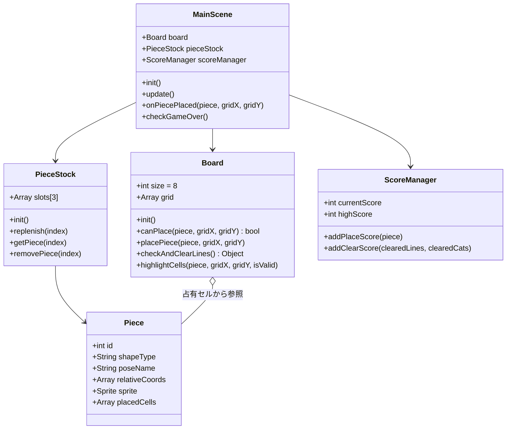
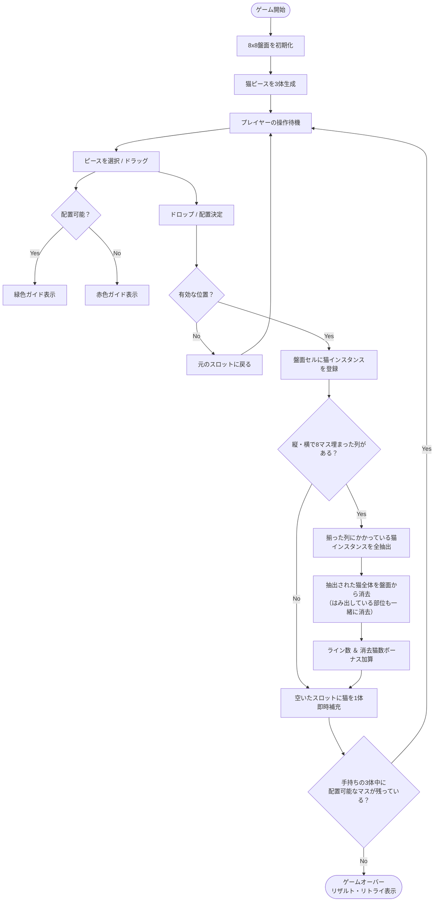

# 『猫タイル』 ゲーム設計書

## 1. ゲーム概要
- **タイトル（仮）**: 猫タイル (Neko Tile)
- **ジャンル**: 8×8 ブロック配置パズルゲーム
- **プラットフォーム**: Webブラウザ (HTML5 Canvas / phina.js)
- **画面解像度**: 500 × 500 px
- **コンセプト**: 様々なポーズをとる可愛い猫たちを8×8のマス目にはめ込んでいくパズルゲーム。ラインが揃うと、**その列にかかっている猫全体が丸ごと成仏（消去）** して一気に盤面が空く、爽快なパズル体験を提供します。

---

## 2. コアルール

### 2.1 盤面（フィールド）
- **サイズ**: 8 × 8 マス（計64セル）
- **初期状態**: 全てのマスが空（配置可能）な状態からスタート。

### 2.2 猫ブロック（ピース）の種類とポーズデザイン
ブロックの形状ごとに、猫の愛らしいポーズが割り当てられます。1マスずつ切り離されたブロックではなく、**「1つのピース＝1匹の猫」** として表現されます。

| サイズ | 形状タイプ | 猫のポーズ・見た目 | 形状イメージ | 回転/種数 |
| :--- | :--- | :--- | :--- | :--- |
| **1ブロック** | 単体 (1x1) | **丸まっている猫**（アンモニャイト / まんまる寝） | `■` | 1種 |
| **2ブロック** | I字 (2x1) | **横向きの猫 / 香箱座りの猫** | `■■` | 横 / 縦 (2種) |
| **3ブロック** | I字 (3x1) | **ぐーんと伸びている猫** | `■■■` | 横 / 縦 (2種) |
| | L字 (2x2内) | **体をくの字に曲げている猫** | `■□`<br>`■■` | 4方向回転 (4種) |
| **4ブロック** | I字 (4x1) | **長〜く伸びきった猫** | `■■■■` | 横 / 縦 (2種) |
| | L字 (3x2内) | **体を直角に曲げた猫** | `■□`<br>`■□`<br>`■■` | 4方向回転 × 左右反転 (計8種) |
| | Z字 (3x2内) | **くねくねと体をひねった猫** | `■■□`<br>`□■■` | 横 / 縦 × S字/Z字 (計4種) |
| | ■ (3x2内) | **太った猫** | `■■`<br>`■■` | 1種 |
| | ■ (3x2内) | **凸猫** | `□■□`<br>`■■■` | 4方向回転 (4種)  |

---

### 2.3 手札（猫スロット）と補充仕様
- **スロット数**: 常に **3体** の猫ピースが表示されます。
- **選択と配置**: プレイヤーは3体の中から好きな猫を1体選び、盤面の空いているマスに配置します。
- **手札の補充**: スロットすべてを盤面に配置すると、空いたスロットに新しい猫が **3体ランダムに補充** されます。
- **確率の偏り**: 手札に補充される猫ピースにはブロック数に偏りがあります。

| ブロック数 | 確率 |
| :--- | :--- |
| 1ブロック | 5% |
| 2ブロック | 30% |
| 3ブロック | 35% |
| 4ブロック | 30% |

---

### 2.4 ライン消去ルール（かかっている猫全体消去）★本作の重要特徴
従来のブロックパズルと異なり、ブロックがバラバラに切断されることはありません。

> [!IMPORTANT]
> **ライン消去のルール**:
> 縦または横の1列（8マス）が揃ったとき、その列のマスだけでなく、**その列に1マスでもかかっている猫ピース全体（本体まるごと）が消去** されます！

#### 例：L字猫や縦長猫の巻き込み消去
以下のように横1列（Row 4）が揃った場合：
- Row 4 を占有している猫のうち、Row 2 や Row 3 に体がはみ出している「伸び猫」や「L字猫」がいた場合、**はみ出している部分も含めてその猫1匹まるごと消滅** します。
- その結果、Row 4 だけでなく、Row 2 や Row 3 にあったマスも一気に空きマスになります。

```
[揃う前の盤面イメージ]
Row 2: . . [猫Aの頭] . . . . .
Row 3: . . [猫Aの胴] . . . . .
Row 4: ■ ■ [猫Aの足] ■ ■ ■ ■ ■  <-- ★横一列（8マス）が揃った！
        ↓
[消去後の結果]
Row 2: . . [ 空 き ] . . . . .  <-- ★猫A全体が消えるため、
Row 3: . . [ 空 き ] . . . . .  <--   はみ出していた上のマスも空く！
Row 4: . . [ 空 き ] . . . . .  <--   Row 4 の他の猫も全体が消去
```

#### お題
お題が表示され、そのお題のターン数以内にクリアできないとお邪魔猫が追加される。お邪魔猫はそれまでにクリアしたお題数に応じて増えていく。

##### お題の仕様
- **表示場所**: 盤面の右側にお題パネルを表示する。
- **構成**:
  - 現在のお題（タイトル・条件・残りターン数）
- **クリア条件**: お題ごとに設定されたターン数以内に条件を達成すること。
- **失敗ペナルティ**: クリアできなかった場合、1x1ブロックのお邪魔猫が盤面にランダムに追加される。お邪魔猫の数はクリア済みお題数に応じて増える。

##### お題の例
- 5ターン以内に1ライン消去する。
- 3ターン以内に10ブロック消去する。
- 4ターン以内に2ライン同時消去する。
- 5ターン以内に丸まり猫を消去する。

##### お邪魔猫の仕様
- **出現条件**: お題を規定ターン数以内にクリアできなかった場合、盤面の空きマスからランダムな位置に追加される（追加数はクリア済みお題数に応じて増加）。
- **配置不可**: お邪魔猫がいるマスには、手札の猫ピースを配置できない。
- **ライン消去対象外**: お邪魔猫はライン消去の判定に含まれない（お邪魔猫がいる行・列は揃わない／お邪魔猫自体はライン消去で消えない）。
- **消滅条件**: お邪魔猫ごとに設定された一定ターン数が経過すると、盤面から消滅する。

#### スコア加算
- **基本点**: 猫を配置したときのマス数に応じた点数。
- **ライン消去点**: 揃ったライン数に応じた基本ボーナス。
- **巻き込みボーナス**: 消去によって同時に消えた「合計猫マス数」に応じた加算ボーナス（大きな猫を巻き込んで一気に消すと高得点）。

---

### 2.5 ゲームオーバー判定
- 手元にある **3体の猫ピースのいずれも、盤面の空きマスに配置できなくなった時点** でゲームオーバー。
- リザルト画面を表示し、最終スコアとハイスコアを表示、リトライ可能とします。

---

## 3. 画面構成・レイアウト設計

画面サイズ: 500 × 500 px（画面幅は変えず、盤面を左寄せにして右側にお題パネルを配置）

```
+---------------------------------------------------+
| [ 猫タイル ]            SCORE: 1250  HIGH: 3400   | <- ヘッダー / スコア表示
+---------------------------------------------------+
|                                 |                 |
|  +----------------------------+ | +-------------+ |
|  | 0,0 | 0,1 | ...      | 0,7 | | | 🎯 お題      | |
|  |-----+-----+----------+-----| | |             | |
|  | 1,0 |     |          |     | | | 1ライン消去 | |
|  |-----+-----+----------+-----| | |             | |
|  | ... |     | 8x8盤面  |     | | | 残り: 1     | |
|  |-----+-----+----------+-----| | | ⏳ 残3ターン | |
|  | 7,0 | ... |          | 7,7 | | +-------------+ |
|  +----------------------------+ |                 |
|                                 |                 |
+---------------------------------+-----------------+
|   [スロット 1]     [スロット 2]     [スロット 3]   | <- 猫ピース手札エリア
|      丸まり猫         横向き猫          伸び猫     |    (なくなると補充)
|        (1x1)           (2x1)            (3x1)     |
+---------------------------------------------------+
```

### エリア別サイズ（暫定）

| エリア | X | Y | 幅 | 高さ |
| :--- | :--- | :--- | :--- | :--- |
| ヘッダー | 0 | 0 | 500 | 50 |
| メイン盤面 | 10 | 55 | 321 | 321 |
| お題パネル | 340 | 55 | 150 | 321 |
| スロットエリア | 0 | 390 | 500 | 110 |

### 操作仕様
- **PC**: マウスによるドラッグ＆ドロップ（またはクリック選択→配置マスをクリック）
- **スマートフォン/タブレット**: タッチドラッグ＆ドロップ（またはタップ選択→配置マスをタップ）
- **ガイド表示**: ドラッグ中、マウス/指の下にある盤面マスをハイライト（緑: 配置可能 / 赤: 重なりや盤面外で配置不可）。

---

## 4. システム・データ構造設計

### 4.1 クラス / モジュール構成



### 4.2 盤面データ表現と消去ロジック
盤面（8×8）の各セルは、配置された **「Piece（猫インスタンス）」への参照** を保持します。

```javascript
// 盤面データ
grid[y][x] = null; // 空きマス
grid[y][x] = pieceInstance; // そのセルを占有している猫インスタンス
```

#### ライン消去アルゴリズム
1. **揃った列の検出**:
   - 行 (y=0〜7) を走査し、8マスすべてが `!= null` の行をリストアップ。
   - 列 (x=0〜7) を走査し、8マスすべてが `!= null` の列をリストアップ。
2. **対象猫のユニーク抽出**:
   - 揃った各行・各列の全セルを走査し、そこに存在する `Piece` インスタンスを `Set` に格納（重複を排除）。
3. **猫全体の消去**:
   - 抽出された各 `Piece` について、その猫が占有していた **すべてのセル（`placedCells`）を `null` にリセット**。
   - 猫スプライトに「消去アニメーション（フェードアウト・跳ねる・ハートが出るなど）」を適用して破棄。
4. **スコア加算**:
   - 揃ったライン数 ＋ 消去された猫の総マス数・頭数からボーナス点を計算。

---

## 5. ゲーム処理フロー



---

## 6. 実装フェーズ（マイルストーン）

1. **フェーズ1: 盤面（8×8）の描画と基本UI**
   - 8×8グリッドの盤面枠描画
   - スコア表示エリア、下部3スロットエリアのレイアウト配置
2. **フェーズ2: 猫ピースの定義と生成**
   - 1〜4ブロックの形状データとポーズ定義
   - 3スロットへのランダム生成・即時補充機能
3. **フェーズ3: ドラッグ＆ドロップと配置処理**
   - マウス/タッチによるドラッグ移動、グリッドへのスナップ
   - 配置可否判定とハイライト表示
   - 盤面データへの猫インスタンス登録
4. **フェーズ4: ライン消去（猫全体消去）とスコア**
   - 縦横のライン判定
   - かかっている猫全体の検出とマス開放
   - 消去エフェクト・スコア加算
5. **フェーズ5: ゲームオーバー判定と演出・調整**
   - 手持ち3体の全マス走査による詰み判定
   - リザルト・リトライ機能
   - ポーズごとの画像/グラフィックの適用

## 7. サウンド仕様

### 7.1. SE一覧
| ID | ファイル名 | 再生タイミング |
|:-|:-|:-|
| SE-neko_spawn | neko_spawn.mp3 | 手札スロット補充時 |
| SE-neko_pick | neko_pick.mp3 | 手札猫をつかんだ時 |
| SE-neko_put_fail | neko_put_fail.mp3 | 手札猫配置失敗時 |
| SE-neko_put_success | neko_put_success.mp3 | 手札猫配置成功時 |
| SE-line_clear | line_clear.mp3 | ライン消去時(1ライン) |
| SE-line_clear_multiple | line_clear_multiple.mp3 | ライン消去時(2ライン以上) |
| SE-line_clear_neko1 | line_clear_neko1.mp3 | ライン消去時猫の鳴き声 |
| SE-line_clear_neko2 | line_clear_neko2.mp3 | ライン消去時猫の鳴き声 |
| SE-line_clear_neko3 | line_clear_neko3.mp3 | ライン消去時猫の鳴き声 |
| SE-line_clear_neko4 | line_clear_neko4.mp3 | ライン消去時猫の鳴き声 |
| SE-line_clear_neko5 | line_clear_neko5.mp3 | ライン消去時猫の鳴き声 |
| SE-block_put | block_put.mp3 | お邪魔ブロック配置時 |
| SE-block_clear | block_clear.mp3 | お邪魔ブロック消去時 |
| SE-mission_clear | mission_clear.mp3 | お題成功時 |
| SE-mission_fail | mission_fail.mp3 | お題失敗時 |
| SE-game_over | gameover.mp3 | ゲームオーバー時 |
| SE-ok_button | ok_button.mp3 | リトライボタン押下時 |

### 7.2. BGM一覧
| ID | ファイル名 | 再生タイミング |
|:-|:-|:-|
| BGM-game | game.mp3 | パズル中 |
| BGM-gameover | gameover.mp3 | リザルト |
