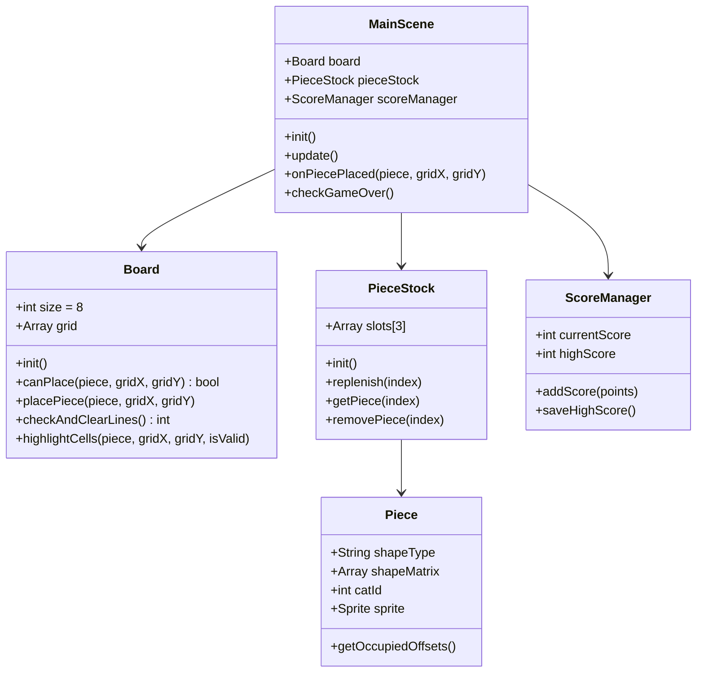
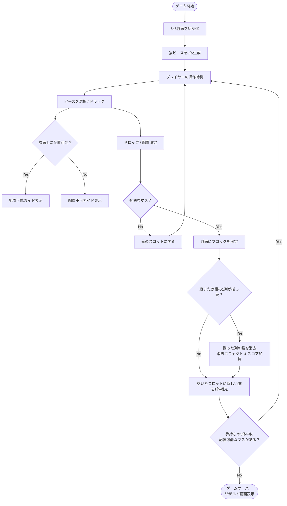

# 『猫タイル』 ゲーム設計書

## 1. ゲーム概要
- **タイトル（仮）**: 猫タイル (Neko Tile)
- **ジャンル**: 8×8 ブロック配置パズルゲーム
- **プラットフォーム**: Webブラウザ (HTML5 Canvas / phina.js)
- **画面解像度**: 500 × 500 px
- **コンセプト**: かわいい猫の形をした様々なブロックを8×8のマス目にはめ込み、縦・横の列を揃えて消していく、手軽で爽快な思考型パズルゲーム。

---

## 2. コアルール

### 2.1 盤面（フィールド）
- **サイズ**: 8 × 8 マス（計64セル）
- **初期状態**: 全てのマスが空（配置可能）な状態からスタート。

### 2.2 ブロック（猫ピース）の種類
プレイヤーが配置できる猫ピースは、以下のサイズ・形状（回転バリエーション含む）で構成されます。

| サイズ | 形状タイプ | 形状イメージ | 回転/バリエーション |
| :--- | :--- | :--- | :--- |
| **1ブロック** | 単体 (1x1) | `■` | 1種 |
| **2ブロック** | I字 (2x1) | `■■` | 横 / 縦 (2種) |
| **3ブロック** | I字 (3x1) | `■■■` | 横 / 縦 (2種) |
| | L字 (2x2内) | `■□`<br>`■■` | 4方向回転 (4種) |
| **4ブロック** | I字 (4x1) | `■■■■` | 横 / 縦 (2種) |
| | L字 (3x2内) | `■□`<br>`■□`<br>`■■` | 4方向回転 × 左右反転 (計8種) |
| | Z字 (3x2内) | `■■□`<br>`□■■` | 横 / 縦 × S字/Z字 (計4種) |

※各ブロックは猫のアイコン画像（「かわいい猫アイコン8匹のグリッド.png」から切り出したテクスチャ）で描画されます。

### 2.3 手札（猫スロット）と補充仕様
- **スロット数**: 常に **3体** の猫ピースが表示されます。
- **選択と配置**: プレイヤーは3体の中から好きな猫ピースを1体選び、盤面の空いているマスに配置します。
- **即時補充**: 1体を盤面に配置すると、空いたスロットに新しい猫ピースが **即座に1体ランダムに補充** されます（常に3択から選択可能）。

### 2.4 ライン消去と連鎖（コンボ）
- **消去条件**: 縦または横の1列（8マス）がすべて猫ブロックで埋まると、その列のブロックが消滅します。
- **同時消去**: 1回の配置で複数列（縦横同時や、複数行・複数列など）が埋まった場合、それらすべての列が同時に消滅します。
- **スコア加算**:
  - ブロック配置時: 配置したブロック数に応じた基本点
  - ライン消去時: 消去した列数に応じたボーナス点（同時消去で高倍率ボーナス）

### 2.5 ゲームオーバー判定
- 手元にある **3体の猫ピースのいずれも、盤面の空きマスに配置できなくなった時点** でゲームオーバー。
- リザルト画面を表示し、最終スコアとハイスコアを表示、リトライ可能とします。

---

## 3. 画面構成・レイアウト設計

画面サイズ: 500 × 500 px

```
+---------------------------------------------------+
| [ 猫タイル ]            SCORE: 1250  HIGH: 3400   | <- ヘッダー / スコア表示
+---------------------------------------------------+
|                                                   |
|      +-------------------------------------+      |
|      | 0,0 | 0,1 | 0,2 | 0,3 | ... | 0,7 |      |
|      |-----+-----+-----+-----+-----+-------|      |
|      | 1,0 |     |     |     |     |       |      |
|      |-----+-----+-----+-----+-----+-------|      |
|      | ... |     | 8x8 グリッド    |       |      | <- メイン盤面
|      |-----+-----+-----+-----+-----+-------|      |    (約320x320 px)
|      | 7,0 | ... |     |     |     | 7,7 |      |
|      +-------------------------------------+      |
|                                                   |
+---------------------------------------------------+
|   [スロット 1]     [スロット 2]     [スロット 3]   | <- 猫ピース手札エリア
|      ■■               ■               ■■■         |    (常に3体待機)
|      ■□              ■■               □□■         |
+---------------------------------------------------+
```

### 操作仕様
- **PC**: マウスによるドラッグ＆ドロップ、またはクリック選択→配置マスをクリック
- **スマートフォン/タブレット**: タッチドラッグ＆ドロップ、またはタップ選択→配置マスをタップ
- ※ドラッグ中は配置候補マスをハイライト表示し、配置可能（緑）/ 配置不可（赤）を視覚的にフィードバック。

---

## 4. システム・データ構造設計

### 4.1 クラス / モジュール構成



### 4.2 盤面データ表現
盤面は 8×8 の2次元配列（または要素数64の1次元配列）で管理します。
- `0`: 空きマス
- `1以上`: 配置済み（猫ブロックのIDやスプライトへの参照）

```javascript
// 例: 盤面配列 (8x8)
grid[y][x] = 0; // 空き
grid[y][x] = { catType: 2, sprite: ... }; // 配置済み
```

### 4.3 ピース形状データ定義（相対座標リスト）
各ピースは原点 (0, 0) を基準とした相対座標ブロックの配列で定義します。

```javascript
const PIECE_DEFINITIONS = {
  // 1ブロック
  "1_SINGLE": [
    [{ x: 0, y: 0 }]
  ],
  // 2ブロック
  "2_I": [
    [{ x: 0, y: 0 }, { x: 1, y: 0 }], // 横
    [{ x: 0, y: 0 }, { x: 0, y: 1 }]  // 縦
  ],
  // 3ブロック
  "3_I": [
    [{ x: 0, y: 0 }, { x: 1, y: 0 }, { x: 2, y: 0 }], // 横
    [{ x: 0, y: 0 }, { x: 0, y: 1 }, { x: 0, y: 2 }]  // 縦
  ],
  "3_L": [
    [{ x: 0, y: 0 }, { x: 0, y: 1 }, { x: 1, y: 1 }],
    [{ x: 1, y: 0 }, { x: 1, y: 1 }, { x: 0, y: 1 }],
    [{ x: 0, y: 0 }, { x: 1, y: 0 }, { x: 0, y: 1 }],
    [{ x: 0, y: 0 }, { x: 1, y: 0 }, { x: 1, y: 1 }]
  ],
  // 4ブロック
  "4_I": [
    [{ x: 0, y: 0 }, { x: 1, y: 0 }, { x: 2, y: 0 }, { x: 3, y: 0 }], // 横
    [{ x: 0, y: 0 }, { x: 0, y: 1 }, { x: 0, y: 2 }, { x: 0, y: 3 }]  // 縦
  ],
  "4_L": [
    // 3x2 のL字パターン各種
  ],
  "4_Z": [
    [{ x: 0, y: 0 }, { x: 1, y: 0 }, { x: 1, y: 1 }, { x: 2, y: 1 }], // 横Z
    [{ x: 1, y: 0 }, { x: 0, y: 1 }, { x: 1, y: 1 }, { x: 0, y: 2 }], // 縦Z
    // S字パターン各種
  ]
};
```

---

## 5. ゲーム処理フロー



---

## 6. 実装フェーズ（マイルストーン）

1. **フェーズ1: 盤面と素材のセットアップ**
   - 8×8グリッドの描画
   - 猫画像アセット（8種類の猫アイコン）の分割スプライト化
2. **フェーズ2: ピース生成とスロット管理**
   - ピース形状データ定義の実装
   - 下部スロットに3体ランダム生成・表示
3. **フェーズ3: ドラッグ＆ドロップと配置判定**
   - ピースのドラッグ操作と盤面グリッドへのスナップ
   - 空きマス判定（はめ込めるかどうかのチェック）
4. **フェーズ4: ライン消去・即時補充・スコア**
   - 縦・横の8マス充填判定とライン消去
   - ピース配置後の即時1体補充
   - スコア計算・表示
5. **フェーズ5: ゲームオーバー判定と演出・UI polish**
   - 盤面全マス走査による配置可能判定（詰みチェック）
   - 消去アニメーション、SE連携、リトライ機能
